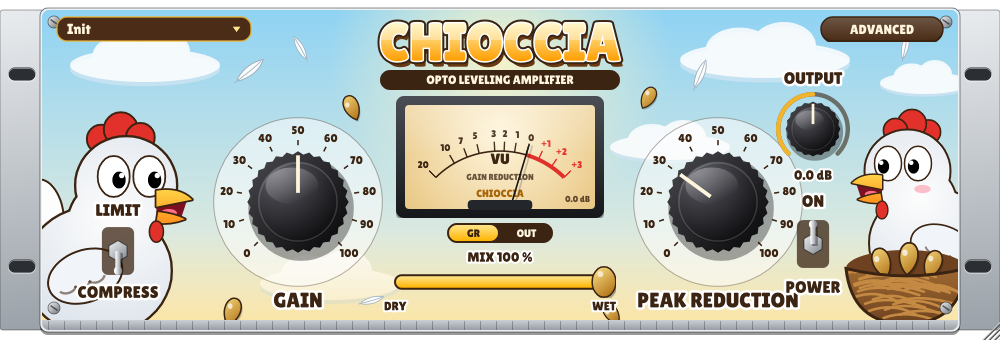

# Chioccia — Opto Leveling Amplifier

Compressore ottico virtuale con codice, nome e grafica originali, ispirato al *carattere* dei
livellatori ottici a valvole degli anni '60. Progettato prima di tutto per la **compressione
parallela** (percorso dry pulito e compensato in latenza), funziona anche come normale
compressore in insert.

> **Nota legale.** Chioccia non è affiliato, approvato o autorizzato da Universal Audio, Teletronix
> o altri titolari di marchi. Nessun codice, logo, risorsa grafica o elemento distintivo di
> interfacce di terze parti è stato usato. I nomi citati nella documentazione servono solo a
> descrivere il riferimento sonoro e appartengono ai rispettivi proprietari. L'immagine di
> riferimento fornita conteneva marchi altrui ("Teletronix", "Chicken Road"): ne sono state riprese
> solo indicazioni estetiche generali (cielo, galline cartoon, accenti dorati, rack, VU crema).



## Stato in sintesi

| Area | Stato |
|---|---|
| Core DSP (cella ottica, detector, colorazione, oversampling, dry/wet) | **Implementato e testato** (102 controlli automatici, Linux) |
| Plug-in JUCE (parametri, stato, preset, bypass, latenza) | **Implementato e testato** (140 controlli, Linux) |
| VST3 Linux x86_64 | **Compilato qui**; pluginval 1.0.4 strictness 10: SUCCESS; validator Steinberg 3.8: 47/47 |
| VST3 Windows / macOS, AU macOS | **Configurato ma non compilato qui**: `build-windows.bat` oppure GitHub Actions (`.github/workflows/build.yml`) |
| VST2 (.dll) | Opzionale, solo con SDK VST2 ottenuto legalmente; disattivato di default, mai necessario |
| Prove in DAW | **Da fare**: nessuna DAW disponibile in questo ambiente |
| Confronto con il plug-in di riferimento | **Da fare**: procedura in [docs/06-validazione.md](docs/06-validazione.md) |

Dettagli completi: [docs/07-stato-progetto.md](docs/07-stato-progetto.md).

## Documentazione

1. [Architettura e percorso del segnale](docs/01-architettura.md)
2. [Parametri (unità, range, default, curve, smoothing, ID)](docs/02-parametri.md)
3. [Modello DSP e approssimazioni dichiarate](docs/03-modello-dsp.md)
4. [Compressione parallela, latenza, oversampling, bypass](docs/04-parallelo-latenza.md)
5. [Compilazione Windows / macOS / Linux e licenze](docs/05-build.md)
6. [Piano di validazione, test in DAW e confronto col riferimento](docs/06-validazione.md)
7. [Funzionalità, limiti noti, verifiche mancanti](docs/07-stato-progetto.md)
8. [Misure generate dal codice](docs/misure/misure.md) · [preset](docs/08-preset.md)

## Compilazione rapida

```bash
# JUCE 9.0.4 viene scaricato automaticamente (FetchContent) — oppure -DCHIOCCIA_JUCE_DIR=/percorso/JUCE
cmake -S . -B build -DCMAKE_BUILD_TYPE=Release
cmake --build build --config Release
ctest --test-dir build -C Release --output-on-failure
```

Il VST3 si trova in `build/Chioccia_artefacts/Release/VST3/Chioccia.vst3`.
Su Windows basta un doppio clic su `build-windows.bat`; senza Windows, carica il progetto su GitHub e scarica lo zip dagli *Artifacts* della run (vedi [docs/05-build.md](docs/05-build.md)).
Istruzioni complete per Visual Studio e Xcode in [docs/05-build.md](docs/05-build.md).

## Struttura

```
CMakeLists.txt            build (core DSP, test, plug-in JUCE)
source/dsp/               core DSP indipendente da JUCE (testabile da solo)
source/plugin/            processore, editor, parametri, preset (JUCE)
source/gui/               look&feel, VU meter, artwork vettoriale, pannello avanzato
tests/core/               test automatici del DSP (nessuna dipendenza)
tests/plugin/             test del plug-in JUCE + snapshot della GUI
tools/measure/            strumento di misura (curve, attacco/rilascio, THD, aliasing)
tools/plot_measurements.py grafici delle misure
assets/fonts/             Lilita One (SIL OFL 1.1)
docs/                     documentazione, misure, screenshot, log di validazione
```

## Licenze di terze parti

- **JUCE 9** — doppia licenza AGPLv3 / licenza commerciale JUCE 9 (Starter gratuita fino a
  20.000 USD di ricavi annui, Indie fino a 300.000 USD, Pro senza limite). Vedi [docs/05-build.md](docs/05-build.md).
- **VST3 SDK 3.8** (incluso in JUCE) — licenza MIT.
- **Lilita One** — SIL Open Font License 1.1 (`assets/fonts/OFL-LilitaOne.txt`).

I codici plug-in (`Plla` / `Chcc`), il nome azienda "Pollaio Audio" e il bundle id sono
segnaposto: vanno sostituiti con valori propri prima di distribuire.
